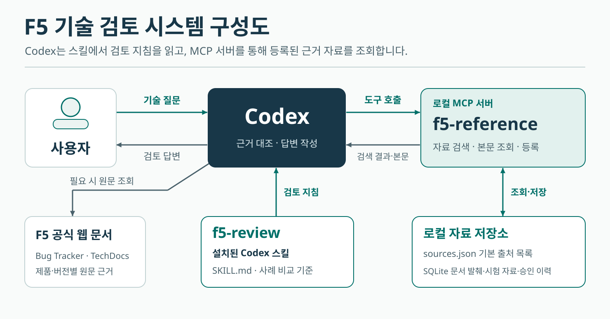

# F5 Review Kit

F5 기능 문의에 공식 문서와 현장 시험 결과를 대조해 답하는 Codex 도구 모음입니다. `f5-review` 스킬이 검토 절차를 제공하고, `f5-reference` MCP 서버가 등록된 문서와 승인 답변을 검색합니다.



## 구성

| 경로 | 역할 |
|---|---|
| [skills/f5-review](skills/f5-review/SKILL.md) | Codex 검토 지침, QUIC 시험 예시, Markdown 보고서 생성기 |
| [mcp/server.mjs](mcp/server.mjs) | 표준 입출력으로 동작하는 Node.js MCP 서버 |
| [mcp/sources.json](mcp/sources.json) | 기본 출처 10개와 확인 상태 |
| [store.mjs](store.mjs) | SQLite 자료·승인 이력 저장소 |

## Windows에서 새로 설치

Node.js 24와 Codex CLI가 있는 환경에서 저장소 루트의 PowerShell을 사용합니다. 추가 npm 패키지는 필요 없습니다.

```powershell
$server = (Resolve-Path 'mcp/server.mjs').Path
$node = (Get-Command node.exe).Source
codex mcp add f5-reference -- $node $server

$skillRoot = if ($env:CODEX_HOME) { Join-Path $env:CODEX_HOME 'skills' } else { Join-Path $env:USERPROFILE '.codex/skills' }
$target = Join-Path $skillRoot 'f5-review'
if (Test-Path -LiteralPath $target) { throw "이미 설치된 스킬을 확인하세요: $target" }
New-Item -ItemType Directory -Force -Path $skillRoot | Out-Null
Copy-Item -LiteralPath 'skills/f5-review' -Destination $target -Recurse
```

기존 설치를 새 저장소 경로로 전환할 때는 `codex mcp get f5-reference`로 현재 서버와 데이터 위치를 확인합니다. 새 서버의 기본 DB 위치는 이 저장소의 `data/desk.sqlite`입니다. 기존 등록 자료와 승인 회신을 계속 사용하려면 기존 DB가 있는 폴더를 지정해 서버를 등록합니다.

```powershell
codex mcp add f5-reference --env "F5_DESK_DATA=<기존 DB 폴더의 절대 경로>" -- $node $server
```

## 사용 예

새 Codex 채팅에 다음과 같이 입력합니다.

> $f5-review BIG-IP PEM에서 QUIC v1의 SNI를 추출할 수 있나요? f5-reference에서 관련 자료를 검색하고, 스킬의 시험 예시와 F5 공식 문서가 각각 확인해 주는 범위를 알려주세요.

서버는 `list_sources`, `search_sources`, `read_source`, `register_excerpt`, `search_approved`, `save_approved`를 제공합니다. 공식 원문을 추가로 열어 확인하는 작업은 Codex가 수행합니다. [QUIC 시험 기록](skills/f5-review/examples/pem-quic.json)은 스킬에 포함된 예시입니다. 새 DB에서도 이 기록을 MCP로 검색하려면 자료 등록을 요청하세요.

시험 표만 생성할 때는 저장소 루트에서 다음을 실행합니다.

```powershell
node skills/f5-review/scripts/report.mjs skills/f5-review/examples/pem-quic.json
```
